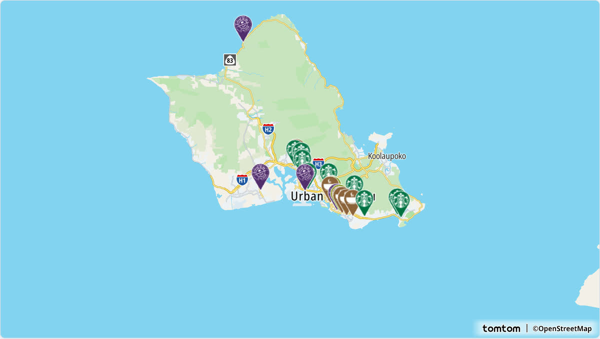

# @mapconductor/react-for-tomtom

TomTom Orbis provider for the MapConductor React SDK. Renders a TomTom map
through MapConductor's provider-independent camera, marker, and overlay API, so
the same application code can also run on Google Maps, MapLibre, Mapbox,
MapTiler, Leaflet, OpenLayers, ArcGIS, Cesium, or HERE.

## Demo

[](https://demo-react.mapconductor.com/tomtom/map/en)

Open it in the [live demo](https://demo-react.mapconductor.com/tomtom/map/en): the same store map runs on every provider, and the page switches between them. The code, cut down to three stores:

```tsx
import { useMemo, useState } from 'react';
import {
  createGeoPoint,
  createMapCameraPosition,
  createMarkerState,
  type MarkerState,
} from '@mapconductor/js-sdk-core';
import { InfoBubble, Markers } from '@mapconductor/js-sdk-react';
import { TomTomDesign, TomTomMapView2D, useTomTomViewState } from '@mapconductor/react-for-tomtom';

const STORES = [
  { id: 'waikiki', name: 'Waikiki', latitude: 21.2793, longitude: -157.8292 },
  { id: 'kailua', name: 'Kailua', latitude: 21.3972, longitude: -157.7394 },
  { id: 'haleiwa', name: 'Haleiwa', latitude: 21.5928, longitude: -158.1034 },
];

const INITIAL_CAMERA = createMapCameraPosition({
  position: createGeoPoint({ latitude: 21.38, longitude: -157.93 }),
  zoom: 10,
});

export default function App() {
  const mapViewState = useTomTomViewState({
    apiKey: 'YOUR_TOMTOM_API_KEY',
    mapDesignType: TomTomDesign.Standard,
    cameraPosition: INITIAL_CAMERA,
  });
  const [selected, setSelected] = useState<MarkerState | null>(null);
  const markers = useMemo(
    () =>
      STORES.map(store =>
        createMarkerState({
          id: store.id,
          position: createGeoPoint({ latitude: store.latitude, longitude: store.longitude }),
          extra: store,
          onClick: marker => setSelected(marker),
        }),
      ),
    [],
  );

  return (
    <div style={{ width: '100%', height: '100vh' }}>
      <TomTomMapView2D state={mapViewState} onMapClick={() => setSelected(null)}>
        <Markers states={markers} />
        {selected && (
          <InfoBubble marker={selected}>
            <strong>{(selected.extra as (typeof STORES)[number]).name}</strong>
          </InfoBubble>
        )}
      </TomTomMapView2D>
    </div>
  );
}
```

Replace `YOUR_TOMTOM_API_KEY` with your own key.

## Installation

```shell
npm install @mapconductor/react-for-tomtom @mapconductor/js-sdk-core @mapconductor/js-sdk-react
```

`@tomtom-org/maps-sdk` is bundled as a dependency and does the actual rendering.

### About the MapLibre version

This package pins `maplibre-gl` to **5.x**, while the other MapLibre-based
providers (`react-for-maplibre`, `react-for-maptiler`) are on 6.x. That is
deliberate: `@tomtom-org/maps-sdk` depends on `maplibre-gl@^5.24.0`, and raising
it would install two copies of MapLibre and hand the TomTom SDK a map object it
was not built against. If you use TomTom alongside MapLibre or MapTiler in one
app, expect two MapLibre versions in the bundle until the TomTom SDK moves to 6.

## API key

TomTom tiles require an API key from the
[TomTom Developer Portal](https://developer.tomtom.com/). Pass it to the view
state:

```tsx
// Your own key. Read it from your environment however your build tool does
// it, and keep it out of source control.
const TOMTOM_API_KEY = '…';

const state = useTomTomViewState({
  apiKey: TOMTOM_API_KEY,
  mapDesignType: TomTomDesign.Standard,
  cameraPosition,
});
```

Without a key the map surface mounts but no tiles arrive.

## Usage

```tsx
import {
  TomTomDesign,
  TomTomMapView2D,
  useTomTomViewState,
} from '@mapconductor/react-for-tomtom';
import { createGeoPoint, createMapCameraPosition } from '@mapconductor/js-sdk-core';

// Your own key. Read it from your environment however your build tool does
// it, and keep it out of source control.
const TOMTOM_API_KEY = '…';

const TOKYO = createGeoPoint({ latitude: 35.6812, longitude: 139.7671 });
const INITIAL_CAMERA = createMapCameraPosition({ position: TOKYO, zoom: 14 });

export default function App() {
  const state = useTomTomViewState({
    apiKey: TOMTOM_API_KEY,
    mapDesignType: TomTomDesign.Standard,
    cameraPosition: INITIAL_CAMERA,
  });

  return (
    <div style={{ width: '100vw', height: '100vh' }}>
      <TomTomMapView2D state={state} />
    </div>
  );
}
```

## Available designs

`TomTomDesign` mirrors the TomTom Orbis style set:

| | |
| --- | --- |
| `Standard` | `StandardLight`, `StandardDark` |
| `Driving` | `DrivingLight`, `DrivingDark` |
| `MonoLight` | `MonoDark` |
| `Satellite` | |

`Standard` and `Driving` follow the light variant; pick the explicit
`…Light` / `…Dark` members when you want to control it yourself.

## Server-side rendering

Import the provider lazily on the client. A static top-level import pulls the
TomTom SDK — a browser library — into a server render:

```tsx
const TomTomMap = lazy(() => import('./TomTomMap'));
```

Note that this package cannot be loaded by Node's own resolver at all — neither
`import` nor `require()`. It reads `maplibre-gl/package.json`, and Node will
only load a JSON module with an import attribute. Bundlers (Vite, webpack,
Next.js) resolve it correctly, which is the supported way to use it.

## License

Apache-2.0
